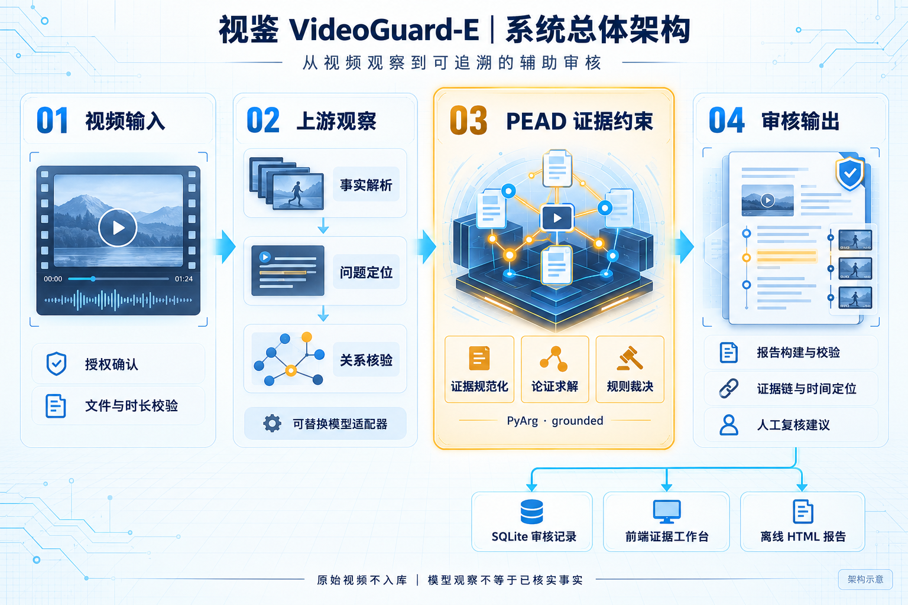
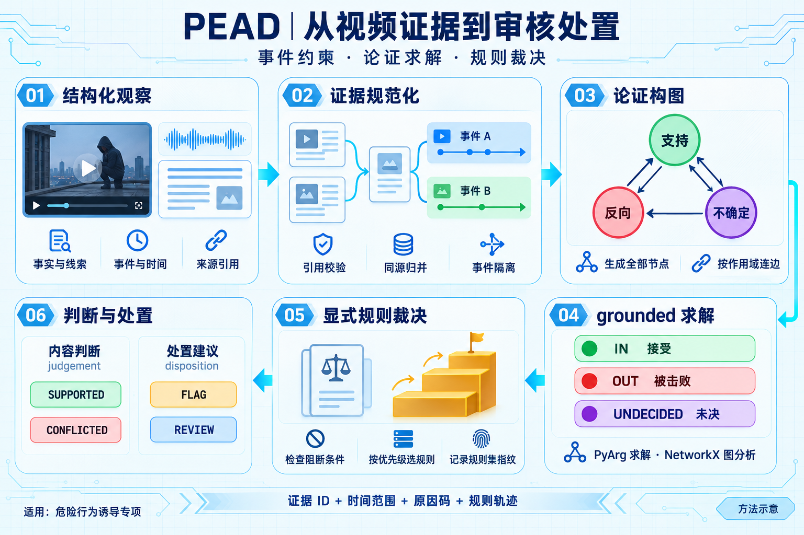
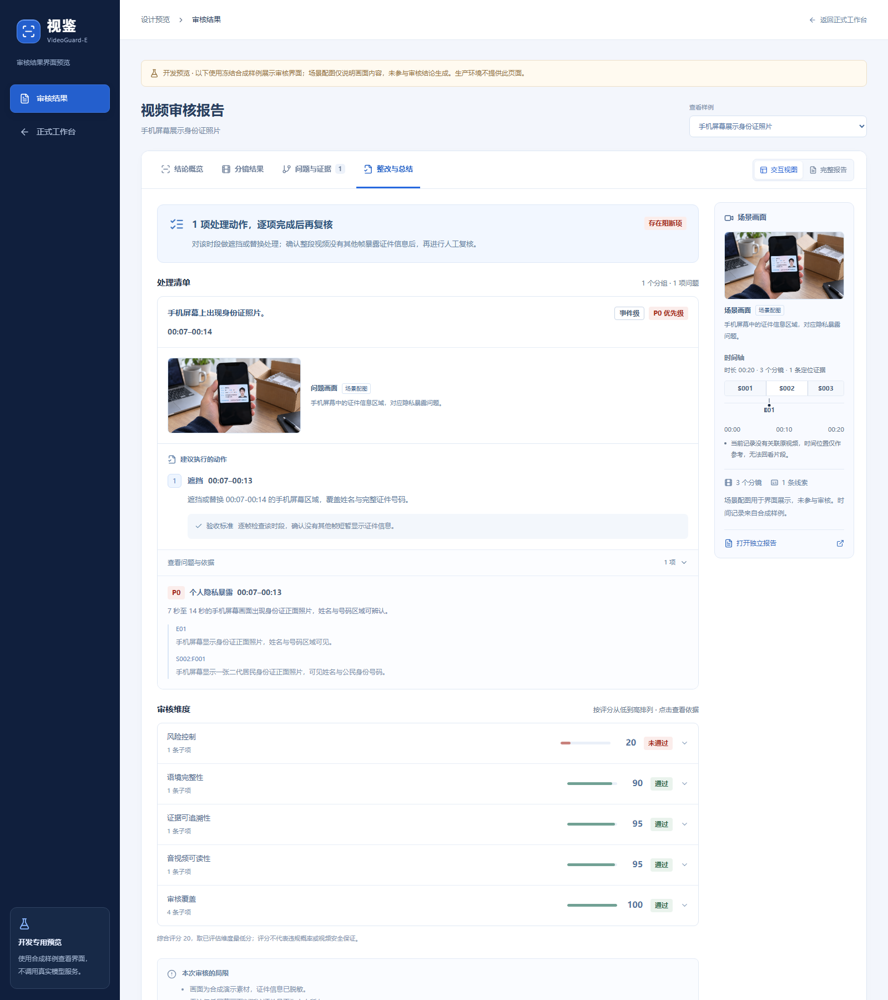
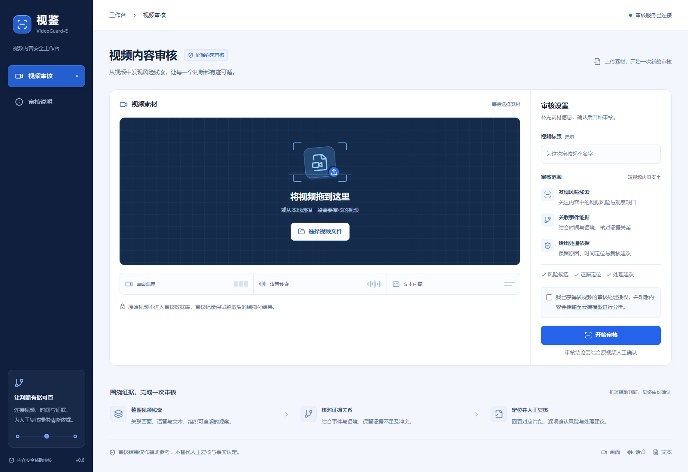

# 视鉴 VideoGuard-E：面向短视频内容安全的事件级证据约束辅助审核系统

> **内部合订参考稿：** 用于核对完整内容、图件与实验口径，不纳入本次分开提交的材料包。独立提交文件见 `docs/submission/00_提交清单与润色说明（不提交）.md`。

**中国研究生网络安全创新大赛 · 创意作品赛 · 作品报告**

| 项目       | 内容                                                                                  |
| ---------- | ------------------------------------------------------------------------------------- |
| 作品名称   | 视鉴 VideoGuard-E                                                                     |
| 赛道       | 中国研究生网络安全创新大赛 · 创意作品赛                                              |
| 作品版本   | v0.6（PEAD 核心基线 `ef68d77`，参赛展示基线 `af3c106`，最终交付 hash 以定稿为准） |
| 验证基线   | Windows 11 · Python 3.11.15 · Node 24 · FFmpeg（`ffprobe`）                      |
| 自动化测试 | 本地后端测试 249 项通过；验证范围见 3.6 节                                            |
| 提交日期   | `REPLACE: 定稿日期`                                                                 |

## 目录

- 摘要
- 第一章 作品概述
- 第二章 作品设计与实现
- 第三章 作品测试与分析
- 第四章 创新性说明
- 第五章 总结
- 参考文献

# 摘要

短视频内容安全审核需要判断画面、话语与字幕是否共同支持同一风险结论。本作品设计并实现 PEAD 事件级证据约束决策引擎：将上游观察规范化为带事件作用域的证据，构造支持、反向与不确定论证，以 grounded 语义求解论证可接受性，再按显式规则输出判断与处置建议。系统保留证据编号、毫秒时间范围、冲突原因与规则轨迹，支持人工复核，并通过规则完整性校验和证据移除检验检查结论依赖。实验采用冻结上游输入的同输入对照设计，隔离模型输出波动，比较有无 PEAD 时的裁决差异。验证覆盖 7 个用例的 64 种关系回答组合、4 类论证形态、31 项契约检查与 249 项后端测试；10 个对照场景中，两处与结构证据矛盾的强提示被转为冲突复核。结果支持给定输入范围内的决策机制，真实视频端到端效果尚待评估。上游遗漏或错误归属仍可能导致误判。本作品用于辅助人工组织证据与定位风险，不替代事实、法律认定及人工审核。

# 第一章 作品概述

## 1.1 现实需求

中央网信办于 2026 年 5 月部署规范短视频内容标注，要求平台提供虚构演绎、AI 生成、营销、转载等必选标签[1]；2026 年 9 月“清朗·整治短视频虚假人设乱象”专项行动进一步关注虚构职业资质、AI 仿冒人物、摆拍编造冲突与营销误导[2]。

这些治理要求使内容来源、传播语义和风险语境成为审核的重要依据。人工复核需要看到结论对应的画面、话语、时间与判断理由。本作品选取**危险行为诱导**作为核心场景，研究证据之间的事件关联与冲突处置；内容真实性、身份与资质真伪仍需外部核验。

## 1.2 现有做法的不足

现有多模态大模型已能根据视频与规则输出疑似风险。SafeWatch（ICLR 2025）已研究多类别视频内容安全检测、策略遵循与透明解释[3]，这些能力构成本作品的相关工作背景。

本作品关注仅依靠标签共现或直接采信关系回答的简化流程中，以下证据处理问题。它们是本项目构造难例与设计约束的依据，不代表已经实测所有现有系统都存在相同缺陷：

1. **标签共现被当作风险成立**：画面出现危险动作、语音出现"试试看"，不足以证明该语音在鼓励模仿该动作；
2. **语境被忽略**：安全科普、新闻报道、影视演绎中的危险画面易被误判；
3. **证据不可追溯**：结论无法回答"由哪几条证据、在什么时间范围、依据哪条规则得出"；
4. **结构矛盾未被利用**：关系模型给出高置信度回答，但其“同一事件”判断与输入中的事件标识矛盾时，需要明确的冲突处理机制。

## 1.3 本作品要解决的问题

> **视频中的几条证据是否真的共同支持同一个风险判断？当"动作""说话""字幕"存在矛盾或证据不足时，系统怎样合理地提示、暂缓或核验，而不是凭空作确定性结论？**

这一问题可以通过程序实现约束，并可用针对性难例比较不同方案。

## 1.4 研究范围

| 类别                                                     | 定位                   | 说明                                       |
| -------------------------------------------------------- | ---------------------- | ------------------------------------------ |
| 危险行为诱导                                             | **核心研究场景** | 可直接测试"动作与传播语义是否指向同一事件" |
| 暴力或危险行为画面                                       | 扩展对照               | 已实现同事件语境核对，未做专项效果实验     |
| 个人隐私暴露                                             | 扩展演示               | 单模态证据即可触发                         |
| 营销与职业资质声称                                       | 扩展演示               | 区分"声称"与"真实性"，需外部核验           |
| 自伤、性内容、仇恨骚扰、诈骗诱导、受控商品、未成年人保护 | 配置覆盖，未做专项实验 | 按线索标签映射判断与处置，详见 2.6 节      |

**明确不宣称**：全面检测所有违规类型；替代人工审核；判定违法、身份或资质真伪。

---

## 1.5 目标用户与场景

| 用户                  | 场景                                           |
| --------------------- | ---------------------------------------------- |
| 短视频创作者 / 运营者 | 发布前自查，提前发现需修改的片段               |
| 平台内容审核人员      | 查看风险候选、证据时间与原因，决定是否人工核查 |

## 1.6 价值主张

- **可追溯**：结论可回溯到具体毫秒与证据 ID，支持人工复核；
- **不越界**：区分"观察到线索"与"事实认定"，资质真伪、违法行为一律转外部核验或人工判断；
- **可降级**：模型失败时显式报错并保留审计记录，不伪装为安全。

## 1.7 局限与改进方向

当前验证集中于危险行为诱导策略，采用冻结上游输入的受控实验检查决策机制。真实模型效果、真实视频准确率及其余九类策略的专项效果尚未验证。PEAD 可以识别输入中的部分缺失与显式冲突，但无法独立发现所有上游遗漏或错误归属；自然语言建议仍需结合原视频核查。具体实验设置与验证范围见 3.1、3.7—3.9 节。

**改进方向**（按收益排序）：

| 方向                       | 说明                                                                                                                                 |
| -------------------------- | ------------------------------------------------------------------------------------------------------------------------------------ |
| 上游假设真实校验           | 使用 `fixtures.upstream_capture` 与 `fixtures.upstream_assumptions` 记录并检查真实回包；单次调用只能说明该样本，不能证明普遍成立 |
| 真实视频小样本效果评估     | 需人工标注，可给出准确率与误报率的初步数字                                                                                           |
| 扩展专项实验到其余九类策略 | 复用现有真值表与攻防验证框架                                                                                                         |
| 上游错误的自纠正           | 需要额外的独立证据源（如二次解析或人工标注），超出当前原型范围                                                                       |

---

# 第二章 作品设计与实现

## 2.1 设计原则

- **单一主线**：视频解析 → 问题定位 → 关系核验（按需）→ **PEAD 证据约束** → 审核报告 → SQLite → HTML 报告；
- **职责可替换**：上游阶段按职责命名而非按供应商命名，通过环境变量配置，更换模型不触碰 PEAD；
- **失败不伪装**：任何阶段的失败都显式标记，绝不静默降级为"无风险"；
- **本地单机**：绑定 `127.0.0.1`，无账号体系、无公网部署、无并发队列。

## 2.2 流水线与阶段职责

```
浏览器上传视频
  → FastAPI 校验（授权 / 6MB / 3 分钟 / 容器签名）+ ffprobe 时长
  → 阶段1 事实解析     videoguard_video_parse_v2    分镜 / 事实 / 事件 / 质量 / 内容分析
  → 阶段2 问题定位     videoguard_issue_locator_v1  逐事件逐标签判定线索
  → 阶段3 关系核验     类型化 Choice/Noul 问答        鼓励 / 警示 / 无关 / 不确定
  → 阶段3.5 PEAD 证据约束（本作品核心）
  → 阶段4 审核报告     videoguard_audit_report_v1   五维度评分 + 整改计划
  → SQLite（单表 reviews）→ 前端展示 + 自包含 HTML 报告
```



**图 1：系统总体架构图（设计示意）**

系统按“视频上传与校验 → 事实解析 → 问题定位 → 关系核验 → PEAD 证据约束裁决 → 报告校验及展示”组织。图中 PEAD 是后台编排中的核心决策层，并非独立部署的微服务；外部模型提供结构化观察，不能由此推断已经完成真实视频端到端模型联调。图为技术架构示意，不是运行时截图。

## 2.3 技术选型

| 组件      | 选型                                            | 理由                                                |
| --------- | ----------------------------------------------- | --------------------------------------------------- |
| 后端      | FastAPI 单进程                                  | 原型规模无需队列/微服务                             |
| 存储      | SQLite 单表                                     | 本地单机演示，无需多表关系                          |
| 前端      | Next.js 16 + React 19 + TypeScript + Tailwind 4 | 类型安全；无外部 CDN 依赖，可离线演示               |
| PEAD 裁决 | 自研规则集 + PyArg（grounded 语义）+ NetworkX   | 见 2.5–2.10 节                                     |
| 运行环境  | Python 3.11+、Node、FFmpeg（`ffprobe`）       | 已有本地运行记录；本次干净克隆验证未完成，见 3.6 节 |

## 2.4 数据与隐私设计

- 上传视频**不落库**：仅保存文件名、SHA256、时长与脱敏后的结构化结果；
- 文本脱敏：手机号、邮箱、身份证在进入持久化数据前替换；
- 跨供应商传输：关系核验只接收最小化、脱敏的结构化文本，不传原始音视频；
- 授权确认：上传前强制勾选素材授权。

---

## 2.5 问题形式化



**图 2：PEAD 证据约束决策流程图（方法示意）**

方法按“结构化观察 → 证据规范化 → 生成论证与攻击关系 → grounded 求解 → 显式规则裁决 → 报告留痕”组织。论证标签描述论证的可接受性，最终输出分别记录内容判断与处置建议，二者不能混用。只有危险行为诱导专项使用该论证求解链路。

证据约束的关系判据可表述为：

```
ValidLink(a, s) = ValidTimestamp(a, s) AND SameTarget(a, s) AND SemanticRelation(a, s)
```

- `ValidTimestamp`：时间戳来自上游观察，由 Python 依据原视频时长检查范围有效性，并按配置窗口检查候选对间距；
- `SameTarget`：以事件作用域标识（`event_id` / `referent_key`）判定，**缺失时不自动认定相同**；
- `SemanticRelation`：关系核验服务返回 `encourages_same / warns_same / unrelated / insufficient`；用于风险支持时，需为通过可信度门限的 `encourages_same`。

该判据描述动作与话语形成风险支持关系的必要条件；最终裁决还需检查反向语境、未决论证与观察完整性。时间接近不能替代事件一致性，事件标识一致也不能独立证明视频事实真实。**毫秒是时间字段的表示单位，不表示已测得毫秒级定位精度。**

**形式化到实现的对应关系：**

| 形式化项             | 实现位置                                       | 不成立时的处置                                                                   |
| -------------------- | ---------------------------------------------- | -------------------------------------------------------------------------------- |
| `ValidTimestamp`   | Python 依据 `ffprobe` 时长校验时间范围有效性 | 事实标记为非法证据，不参与裁决                                                   |
| `SameTarget`       | `event_id` / `referent_key` 的作用域比较   | 归入未决事件，转人工复核而非默认相同                                             |
| `SemanticRelation` | 关系核验适配器 + 可信度门限                    | 缺失或不足时保留复核；无关回答不构成该对的支持；警示或结构矛盾进入反向与冲突处理 |

## 2.6 规则工程化

危险行为诱导的论证生成与最终裁决由**可校验、带版本、可追溯的规则集**驱动：

| 组成       | 规模   | 说明                                   |
| ---------- | ------ | -------------------------------------- |
| 论证规则   | 14 条  | 生成"支持 / 反向 / 不确定"三类论证节点 |
| 决策规则   | 11 条  | 按显式优先级选出一条裁决               |
| 规则集指纹 | SHA256 | 每次裁决记录所用规则集指纹             |

**适用范围必须讲清**：上述规则集与论证求解目前只服务于**危险行为诱导**这一策略——它是本项目深度研究的对象。其余九类处于不同深度，不应被理解为同等核验：

| 策略               | 实际判断方式                                                            |
| ------------------ | ----------------------------------------------------------------------- |
| 危险行为诱导       | PEAD 证据图 + 可废止论证 + 关系门控（**唯一**使用论证求解的策略） |
| 暴力或危险行为画面 | 动作线索 + 同事件语境核对（区分新闻/影视/教育语境）                     |
| 个人隐私暴露       | 线索 + 模态与时间定位过滤                                               |
| 营销及资质声称     | 资质线索引向外部核验，营销线索引向人工复核                              |
| 其余六类           | 按配置的线索标签直接映射为判断与处置，不含同事件语境核对                |

因此"覆盖十类风险线索"指的是**覆盖十类线索与处置路径**，不等于十类都经过证据关联论证。扩展到其余九类是明确的后续方向，不是已完成能力。

**规则集自我保护（`RuleSet.integrity()`）**：规则集加载时强制校验以下约束，违反即拒绝加载——

- 生成侧关键规则按 **ID 与精确条件**固定，删除或改写即报错；
- **支持论证的生成规则也被固定**：只保护保守分支并不够，把 `A_LOCAL_PROMOTION` 改得更严会让风险论证根本生成不出来，从而在没有任何守卫命中的情况下消失；
- **支持裁决规则（`D_LOCAL_SUPPORTED` / `D_MODEL_SUPPORTED`）同样被固定**：删掉它们，已接受的支持证据会落到默认的"暂不支持"；
- **语义不变量**：加载后立即用"存在已接受支持、无任何阻断条件"的事实集试跑一遍裁决，结果必须是 `SUPPORTED / FLAG`——不是只检查规则 ID 还在；
- 任何输出 `FLAG` 的规则必须含 `accepted_support`；
- 失败守卫（模型不可用 / 资源超限 / 证据非法）必须优先于普通决策；
- 保守裁决（指代冲突 / 立场冲突 / 不确定 / 覆盖不足）按条件与结论锁死。

这些约束用于防止受保护的支持路径与复核条件因配置修改而失效。新增或调整规则仍需通过加载校验与回归验证；完整性校验不构成对任意配置组合安全性的形式化证明。

**十类策略配置同样受校验（`src/policy_config.py`）**：规则完整性只管危险诱导这一策略，其余九类的判断写在 `policies_v03.json` 里，因此需要另一道同性质的保护——

- 十个策略必须存在、不得改名，未登记的 ID 直接拒绝；
- 每个策略声明的最低风险线索集不得被删除（可以增加线索，不能减少）；
- 高危策略的处置不得弱于下限（自伤 / 性内容 / 未成年人保护至少 `FLAG`，骚扰 / 诈骗 / 受控商品至少 `REVIEW`）；
- 处置值必须在允许的枚举内。

**每类策略都要说清"没发现"和"没法判断"的区别**：只检查全片覆盖并不够——时间线完整不代表口播或字幕被可靠识别。各策略声明必需模态，必需模态未完成观察时返回 `UNKNOWN / RECHECK`，而不是 `NOT_SUPPORTED / NONE`。已检出的线索照常报出，同时记录 `evidence_confidence`：**风险严重度与证据可信度分开表达**，低置信度的高危线索仍可给出强处置，但会明确标注需人工确认。

**证据可信度是贯穿到出口的契约，不是某个模块的字段**：置信度由每条 finding 实际引用的线索统一计算（十类策略同一条规则），并强制写入报告——低置信度的活跃 finding 必须对应一条**绑定其证据 ID** 的核实说明，否则报告校验不通过；导出 HTML 与界面整改页都会显示这条说明。只写"需人工复核"而不指向具体证据，不算满足该约束。

**适用边界**：在校验器及执行代码可信、按既定加载路径运行的前提下，违反上述约束的配置会被拒绝；该机制不防止源代码被改写，也不验证上游观察的真实性。

## 2.7 可废止论证与 grounded 求解

本作品采用 Dung 抽象论证框架组织论证与攻击关系[4]。框架可记为 `AF = (A, R)`，其中 `A` 是论证集合，`R` 是有向攻击关系；grounded 语义通过最小不动点确定可接受论证，得到接受、被击败与未决标签。此处采用的是既有论证方法，项目实现集中于视频证据如何映射为论证及业务裁决。

1. **证据规范化**：观察按事件作用域分组，同源线索合并（相同 `source_refs` 与命题视为同一观察），避免同一份证据被重复计为独立佐证；模型判断标记为 `model_is_independent_evidence: False`；
2. **论证构造**：按论证规则生成节点，带极性（SUPPORT / COUNTER / UNCERTAINTY）、前提证据 ID、来源事实引用；
3. **grounded 求解**：由 PyArg[5] 求解 `IN`（接受）/ `OUT`（被击败）/ `UNDECIDED`（未决）标签；NetworkX[6] 支持图结构分析，项目代码据此生成攻击者、防御链、未决攻击者与循环解释；
4. **规则裁决**：按优先级选出一条决策规则，输出 judgement / disposition / reason_code。

**不静默降级**：求解失败或超出资源预算时抛出 `ArgumentationLimitError` 并转人工复核，`fallback=False`。

## 2.8 判定与处置分离

| 维度                     | 取值                                                                                |
| ------------------------ | ----------------------------------------------------------------------------------- |
| 内容判断 `judgement`   | `SUPPORTED` / `NOT_SUPPORTED` / `INSUFFICIENT` / `CONFLICTED` / `UNKNOWN` |
| 处置建议 `disposition` | `FLAG` / `NONE` / `REVIEW` / `VERIFY_EXTERNAL` / `RECHECK` / `RETRY`    |

避免将全部视频简化为"合规/违规"二分。

## 2.9 可追溯与可复现

- 每条结论可回答：**哪条规则触发、哪些证据 ID 支持或反驳、发生在什么时间范围、哪些信息未核实、建议人工做什么**；
- 每条 finding 携带**反证 provenance**：是否检查过反证、检查范围、是否发现、是否调用语义核验——"已检查且无"与"未检查"在报告中读起来不同；
- 规则集指纹与引擎版本记录在每次裁决结果中。

**冻结输入下的证据移除检验**：对选定的支持或反向证据，连同其同源别名一起移除，保持关系回答、候选对编号和规则快照不变，重新计算全局与逐事件裁决，记录结论、处置或原因码的变化。检验受资源预算限制，截断或跳过会留痕。这能检查当前结论对给定证据的依赖，不能解释为重新分析真实视频后的因果效果。

**攻击边的作用域与顺序无关性**：

| 性质             | 说明                                                                                                                                         |
| ---------------- | -------------------------------------------------------------------------------------------------------------------------------------------- |
| 构图分两阶段     | 先生成全部论证节点，再按完整节点集合连边。否则"冲突否定模型支持"这类边是否存在，取决于两条规则的优先级高低——改一个优先级就能让结构冲突失效 |
| 攻击边按话语限定 | 某条话语"关系未核验"只阻断它自己产生的支持。若按动作作用域连边，第四条未核验话语会连带击倒前三条已核验的支持，独立成立的风险被无关话语取消   |
| 未决与结论分离   | "支持是否存活"由 grounded 标签决定，"能否给出风险结论"由显式规则决定：存在开放未决时转人工复核，但支持与证据照常保留                         |

## 2.10 结构约束的作用：四类论证形态

实测四类攻防形态（`python -m fixtures.argumentation_report`）：

| 场景                         | 论证与 grounded 标签                                                        | 攻击边                                         | 含义                       |
| ---------------------------- | --------------------------------------------------------------------------- | ---------------------------------------------- | -------------------------- |
| 同事件「鼓励」vs「反向语境」 | `LOCAL_PROMOTION` **OUT**，`COUNTER_CONTEXT` **IN**         | 3 条（双向，含 2-环）                          | 双向攻击下支持论证被击倒   |
| 跨事件：模型断言同一事件     | `MODEL_PROMOTION` **OUT**，`REFERENT_CONFLICT` **IN**       | `REFERENT_CONFLICT → MODEL_PROMOTION`       | 结构冲突否决模型的自信回答 |
| 跨事件：模型声称警示同源     | `MODEL_COUNTER` **OUT**，`COUNTER_REFERENT_CONFLICT` **IN** | `COUNTER_REFERENT_CONFLICT → MODEL_COUNTER` | 模型的反向论证自身被否决   |
| 纯支持、无冲突               | 全部 **IN**，攻击 0 条                                                | 无                                             | 约束不无故压制正常结论     |

**第二、三个场景展示模型关系判断被结构约束否决；第一个场景展示缺失关系与显式警示共同作用时的保守裁决。**

**这一节展示 PEAD 约束如何实际生效。** grounded 标签取决于完整攻击与防御关系，不能只按环的奇偶推断。
第一个场景中，无攻击者的 `RELATION_MISSING` 被接受，击倒 `LOCAL_PROMOTION`，进而防御 `COUNTER_CONTEXT`。
孤立的相互攻击也可能全部未决；本节四个场景未出现 `UNDECIDED`，不代表其他输入不会产生该标签。


**图 3：独立工程测试样例生成的论证攻防页面。**

---

## 2.11 接口

| 方法 | 路径                         | 作用                                                    |
| ---- | ---------------------------- | ------------------------------------------------------- |
| GET  | `/api/health`              | 服务健康状态                                            |
| POST | `/api/reviews`             | 上传视频并审核（`multipart/form-data`）               |
| GET  | `/api/reviews/{id}`        | 查询已保存的审核结果                                    |
| GET  | `/api/reviews/{id}/report` | 获取自包含 HTML 审核报告                                |
| GET  | `/api/demo/cases`          | 查询五套冻结展示样例（18 套工程回归样例单独保留） |
| POST | `/api/demo?case={case_id}` | 回放冻结输入，经正式 PEAD 编排后保存 DEMO 记录 |

## 2.12 界面

单页本地工作台，无需账号。上传区提供视频预览与授权确认；结果区提供独立报告访问及四个标签页：

| 标签页                           | 内容                                                                                 |
| -------------------------------- | ------------------------------------------------------------------------------------ |
| **结论概览** `brief`     | 审核结论、观察覆盖、证据与待处理数量、处置一览                                       |
| **分镜结果** `shots`     | 分镜摘要、时间范围与记录事实数量                                                     |
| **问题与证据** `audit`   | 逐事件的判断/处置/原因，附支持与反证证据；**点击证据时间点可回看原片对应片段** |
| **整改与总结** `summary` | 五维度评分、问题定位、整改建议与局限说明                                             |

**界面自身即承载证据边界**：上传页固定显示提示——"审核结论仅作辅助参考，需结合原视频
人工核查"；证据视图提供时间点回看，便于人工核对模型观察是否属实。

图 4—6 以五套冻结展示样例呈现结论、证据与整改流程，场景配图用于辅助理解画面内容。样例的输入设置与验证方法见 3.1 节。正式工作台提供视频上传与审核，结果页组织结论、证据和处理建议。

**受控对照：动作观察保持相同，仅改变后续口播立场**

| 时间段       | 视频解析中的可观察事实                                               | 对照变量               |
| ------------ | -------------------------------------------------------------------- | ---------------------- |
| 00:06–00:15 | 同一男子在十二层楼天台翻越护栏，跨过约两米楼间空隙，见 `S002:F001` | **两组保持相同** |
| 00:15–00:19 | A：男子说『你们也试试，胆大一点就行，别怕』                          | `E02` 是鼓励         |
| 00:15–00:20 | B：男子说『千万别学我，这里没有任何防护，摔下去就是重伤』            | `E02` 是警示         |

两组动作均引用 `S002:F001`，口播均位于 `S003:F001`；固定动作和事件归属，仅改变话语立场，观察其对裁决的影响。

> **对照要点：两组动作画面相同，变化的是后续口播。** A/B 复用同一张动作配图，以保持画面条件一致。下方直接列出口播原句及其判断作用，便于对照结果。

| A · 鼓励模仿 | B · 明确劝阻 |
| --- | --- |
| **后续口播：“你们也试试，胆大一点就行，别怕。”** | **后续口播：“千万别学我，这里没有任何防护，摔下去就是重伤。”** |
|  |  |
| **PEAD 判断依据：** `E01` 危险动作与 `E02` 鼓励话语指向同一事件，形成诱导支持论证。 | **PEAD 判断依据：** `E02` 是针对同一动作的警示语境，作为反向证据；本组未形成诱导支持关系。 |
| `R_DANGER_PROMOTION: SUPPORTED / FLAG`；系统报告 `BLOCKED / 20` | `R_DANGER_PROMOTION: NOT_SUPPORTED / NONE`；系统报告 `PUBLISHABLE / 90` |

**图 4：同一动作、不同口播立场的对照。**

**结果解读：** B 未形成危险行为诱导的支持关系；这不表示跨楼动作安全。`PUBLISHABLE` 是当前观察与策略配置下的系统总评，其他平台规范仍需人工核验。


**图 5：跨事件错误关联的冲突处置。**

厨房的 `EVT_STOVE` 和骑行的 `EVT_BIKE` 是不同事件，冻结的关系回答却为 `encourages_same`。PEAD 的事件结构约束保留该冲突，输出 `CONFLICTED / REVIEW`，交由人工核查。



**图 6：屏幕证件信息的定位与整改。**

样例观察将手机屏幕证件信息定位到 00:07–00:14，报告将该时间范围、证据引用与遮挡姓名及号码区域的建议关联起来。



**图 7：正式视频上传与审核设置界面（2026-10-21）。** 展示未选择视频、尚未提交审核的正式表单。

## 2.13 运行方式

分别在两个终端中，从仓库根目录执行下列命令，并按 `.env.example` 配置模型服务。正式工作台用于视频上传与审核，冻结输入回放用于工程验证。

```bash
# 终端一
cd backend
uv sync --python 3.11
uv run python -m uvicorn main:app --host 127.0.0.1 --port 8000

# 终端二
cd frontend
npm ci
npm run dev
```

---

# 第三章 作品测试与分析

## 3.1 验证策略：冻结上游输入的消融实验

本作品的研究对象是 PEAD 决策层，采用**冻结上游输入、比较下游裁决**的受控实验。将事实解析、问题定位与关系核验的结构化输入保存为固定快照，同一用例的有 PEAD 与无 PEAD 分支共享相同输入及哈希，比较决策机制带来的差异。

**输入与执行方式**：本次快照由按测试目标预先构造并固定的分镜事实、事件、风险线索与关系回答组成，覆盖鼓励、警示、缺失和跨事件冲突等条件。PEAD 论证构建、求解、规则裁决及报告协议校验均执行项目代码；展示报告文案按案例编排，用于检查协议与界面流程，其文本生成质量不列入本次评价指标。

**对照条件**：有、无 PEAD 对照在同一用例内保持上游输入一致，避免模型输出波动混入比较；图 4 的 A/B 语境对照则保持动作与事件归属一致，仅改变后续口播立场。前者比较决策分支，后者检查语境变化下的裁决行为。

本实验评价给定输入条件下的决策行为，不估计真实视频端到端准确率。验证范围与上游输入假设见 3.7—3.9 节。

## 3.2 穷举决策真值表

本研究将关系核验限定为四种枚举取值，并针对已选定的 7 个含候选对样例穷举其可达组合。这里的“穷举”不覆盖所有视频内容和事件结构：

```bash
python -m fixtures.truth_table --write    # → backend/reports/pead-truth-table.md
```

**规模**：7 个含候选对的用例合计 **64 种关系回答组合**，每种组合运行两遍。该数量是各样例可达组合数之和。

**检查项目及范围**：

| 性质                       | 含义                                                                                                                  |
| -------------------------- | --------------------------------------------------------------------------------------------------------------------- |
| **枚举范围内全定义** | 64 种组合均能产生裁决，未抛出异常；不表示真实风险无漏检                                                               |
| **重复运行一致**     | 每种组合两次运行的 judgement、disposition、reason_code 一致                                                           |
| **输出字段检查**     | judgement、disposition 属于允许枚举，reason_code 非空；不等同于穷尽所有报告约束                                       |
| **单候选对保守性**   | 仅对单候选对样例，按测试定义的处置强度，检查三个替代回答不强于 `encourages_same`；未证明多候选图的全局单调性        |
| **两类警示标注回归** | 检查 `warning_context` 与 `counter_context_tagging` 两个样例在枚举回答下均不产生 FLAG；不要求两者所有判断完全相同 |

**双候选对的实际行为**：在 `danger_promotion` 样例中，两对均回答 `encourages_same`，或一对回答 `encourages_same`、另一对回答 `unrelated`，均输出 `SUPPORTED / FLAG`。无关候选不必否决独立成立的支持；未核验回答、警示回答及已有反向语境按相应规则处置。

## 3.3 论证攻防验证

见 2.10 节。产出 `backend/reports/pead-argumentation.md` 与自包含 HTML 演示页（无脚本、无外链、可离线打开）。

**从冻结观察到审核结论：一条可复查的完整链路。** 以独立工程测试样例中“跨事件、模型错误回答鼓励同一事件”为例，将项目实际生成的论证记录串联如下：

| 环节              | 项目运行记录中的内容                                               | 为什么重要                             |
| ----------------- | ------------------------------------------------------------------ | -------------------------------------- |
| 结构化观察        | 线索 `E01`、`E02` 被归入不同事件                               | 时间接近不能替代事件一致性             |
| 候选关系核验      | 构造性的关系回答为 `encourages_same`                             | 关系回答只是上游输入，尚未成为独立事实 |
| 支持论证          | `MODEL_PROMOTION:["E01","E02"]`                                  | 表示模型关系产生的候选支持             |
| 结构冲突论证      | `REFERENT_CONFLICT:["E01","E02"]`                                | 不同事件的指向与“鼓励同一事件”矛盾   |
| 攻击关系          | `REFERENT_CONFLICT → MODEL_PROMOTION`                           | 结构冲突攻击模型支持                   |
| grounded 论证求解 | `REFERENT_CONFLICT = IN`，`MODEL_PROMOTION = OUT`              | 模型支持被击败，不能直接采信           |
| 最终裁决          | `CONFLICTED / REVIEW`，原因码 `RELATION_REFERENT_DISAGREEMENT` | 保留结构冲突并交由人工核查             |

该案例的证据编号、论证标签、攻击边和裁决可在 `backend/reports/pead-argumentation.md` 的第二个工程案例中核查；输入与执行方式见 3.1 节。


**图 8：跨事件误关联的结构约束示意（非测试截图）。**

图 8 以事件 A 的动作观察与事件 B 的话语观察解释作用域冲突：`encourages_same` 回答生成模型支持候选，结构冲突论证攻击该候选，示意 `IN / OUT` 标签与 `CONFLICTED / REVIEW` 的关系。具体运行记录见上表引用的工程报告。

## 3.4 同输入对照实验

```bash
python -m fixtures.compare_pead --write    # 生成同输入对照报告
```

两个分支共享同一冻结输入快照，并以输入哈希校验一致性。对照组采用带有基础缺失、低可信复核逻辑的简化关系映射，不调用 PEAD 引擎；实验组启用 PEAD 证据约束裁决，比较两者在相同观察和关系回答下的处理结果。

**对照组设定**：共享解析、协议校验、候选对选择与置信门限；简单映射包含"缺服务""低可信""混合回答"的复核处理。

| 场景                                         | 预设处置预期 | 无 PEAD        | 有 PEAD          | PEAD 原因                          |
| -------------------------------------------- | ------------ | -------------- | ---------------- | ---------------------------------- |
| 明确鼓励同一危险动作                         | FLAG         | FLAG           | FLAG             | `RELATION_LINK_ASSISTED`         |
| 明确警示不要模仿                             | NONE         | NONE           | NONE             | `NO_SUPPORTING_RELATION`         |
| 模型确认鼓励话语与动作无关                   | NONE         | NONE           | NONE             | `RELATION_UNRELATED_CONFIRMED`   |
| 关联未核验，保留复核                         | REVIEW       | REVIEW         | REVIEW           | `MISSING_SEMANTIC_RELATION`      |
| 新闻画面未提供危险诱导线索                   | NONE         | NONE           | NONE             | `NO_SUPPORTING_RELATION`         |
| **不同事件，模型却自信答鼓励同一动作** | REVIEW       | **FLAG** | **REVIEW** | `RELATION_REFERENT_DISAGREEMENT` |
| **同一事件有警示，模型却自信答错**     | REVIEW       | **FLAG** | **REVIEW** | `CONFLICTING_STANCE`             |
| 鼓励与教育警示的立场冲突                     | REVIEW       | REVIEW         | REVIEW           | `CONFLICTING_STANCE`             |
| 观察不完整，不能放行                         | REVIEW       | REVIEW         | RECHECK          | `INCOMPLETE_OBSERVATION`         |
| 完整观察且无诱导线索                         | NONE         | NONE           | NONE             | `NO_SUPPORTING_RELATION`         |

**差异集中在两处**：当冻结的关系回答置信度较高、但**与结构证据矛盾**时，无 PEAD 简化映射分支输出 FLAG，与预设处置预期不符；PEAD 分支保留冲突并转人工复核，与 2.10、3.3 节展示的约束机制一致。

| 组别    | 强提示 FLAG | 暂无动作 NONE | 复核桶      |
| ------- | ----------- | ------------- | ----------- |
| 无 PEAD | 3           | 4             | 3           |
| 有 PEAD | **1** | 4             | **5** |

符合预设处置预期的场景数：无 PEAD **8/10**，有 PEAD **10/10**。

`reference_action` 为测试设计预先声明的处置预期；上述计数表示用例符合情况，不作为视频准确率。用例按测试目标选取；64 种穷举组合中有 17 种处置桶不同，差异数量不直接等于改善数量。本项覆盖危险行为诱导策略。

## 3.5 上游契约静态校验

若提示词要求的字段、枚举或对象结构与运行时校验器不一致，真实回包可能在解析阶段被拒绝。项目对其中可静态比对的约定进行检查：

```bash
python -m fixtures.prompt_contract --write   # → backend/reports/prompt-contract.md
```

检查四个阶段的部分字段与枚举约定。**当前 31 项全部通过**，仅表明这些检查未发现不一致；检查器未穷尽所有嵌套字段、类型与跨字段约束，不能保证完整 JSON 契约无缺陷，也不能证明真实模型遵循协议。

## 3.6 工程回归与可复现性

| 项               | 规模 / 结果                                                                                                                          |
| ---------------- | ------------------------------------------------------------------------------------------------------------------------------------ |
| 后端自动化测试   | 2026-10-20 本地复核 **249 项通过**；该数量指后端测试套件，不与其他检查数字相加                                                 |
| 工程回归样例     | **18 套**，覆盖全部 10 类风险策略                                                                                              |
| 参赛展示样例     | **5 套**，包含固定事实、口播和符合当前协议的报告                                                                               |
| 一致性检查       | 样例数据、同输入对照报告、论证 HTML 与 prompt 契约均提供检查入口                                                                     |
| 本次干净克隆验证 | **未完成**：克隆阶段发生 `fetch-pack: invalid index-pack output`，未进入新目录安装与测试，不能据本地结果宣称本次克隆复现通过 |
| 运行环境实测     | Python **3.11.15**、Node 24                                                                                                    |

本地验证与干净环境复现分别记录。最终交付时需将测试日志绑定实际 commit、日期与环境，并在新的干净克隆中完成 `uv sync`、后端检查、`npm ci`、类型检查与构建；本次传输失败的原因尚未定位，不能据此判断代码或依赖在新环境中的运行结果。

**过程中发现并修复的缺陷**（每项均有回归测试固定）：

| 缺陷                                      | 影响                                           |
| ----------------------------------------- | ---------------------------------------------- |
| 降级报告在"无事件归属"的 finding 上抛异常 | 覆盖不完整——最需要降级路径的场景——反而失败 |
| 关系核验的 `unrelated` 结论被丢弃       | 语义否证无法生效，只能全量转人工               |
| 未评估维度被给予 90 分 PASS               | 制造了没人看过的维度评分                       |
| `report.py` 在 Python 3.11 下语法错误   | 声明支持 3.11 但实际无法导入                   |
| 5 处文件读写未指定 UTF-8 编码             | 中文 Windows 下测试无法运行                    |
| 反证语境只认单一标签                      | 结论取决于标注用词                             |

---

## 3.7 已验证与未验证

| 状态               | 内容                                                                                                                                                                       |
| ------------------ | -------------------------------------------------------------------------------------------------------------------------------------------------------------------------- |
| **已验证**   | 冻结测试输入与枚举组合下的 PEAD 决策行为、单候选对保守性及四类论证形态；受保护规则与策略配置的校验；本地 249 项后端测试；31 项 prompt 契约静态检查；本地前端运行与构建记录 |
| **尚待完成** | 本次交付版本的干净克隆安装、完整测试与构建复现；最终 commit 与验收日志归档                                                                                                 |
| **未验证**   | 真实模型端到端联调；真实回包是否稳定满足输入假设；真实视频准确率、误报率、召回率及业务收益；其余九类策略的专项效果                                                         |

本地验证环境为 **Windows 11 + Python 3.11.15 + Node 24**。仓库配置了 Ubuntu 上的后端测试与样例检查，以及前端类型检查和构建；CI 配置本身不作为某次运行已通过的证据。前端生产构建也不等于已完成可执行程序打包分发。

## 3.8 上游假设与其风险

PEAD 依赖上游四项假设，**本作品尚未用真实模型回包验证**：

| 假设                       | 不成立时的后果                                                                       |
| -------------------------- | ------------------------------------------------------------------------------------ |
| 事件带可用的指向标识       | 标识缺失会削弱事件关联，按缺失与未决路径处理；看似合法但语义错误的标识可能无法被发现 |
| 线索与事件标识一致         | 可检测的不一致会触发校验或复核；错误但内部一致的归属仍可能引入错误支持或反证         |
| 线索引用的事实真实存在     | 悬空引用可被协议校验发现；引用存在并不表示所描述的画面或话语真实准确                 |
| 解析标记的反向语境进入线索 | 遗漏警示会使引擎看不到反证，可能误判为诱导，无法保证自动转入复核                     |

**已为此提供校验工具**（`fixtures.upstream_capture` + `fixtures.upstream_assumptions`），但**本次未执行真实调用**。

**可检测异常与未知错误应分别处理**：对可检测的缺失、非法证据、显式冲突或求解超限，系统保留复核、重查或重试路径；对上游未报告的警示、错误但内部一致的事件归属，以及观察本身失真，PEAD 缺乏独立信息源，仍可能误报或漏报。上述工具检查的是回包内部约束，不能替代原视频人工标注。

## 3.9 结果解释与后续验证

当前实验支持的结论是：在已声明的冻结输入与枚举范围内，PEAD 能按规则保留事件冲突、处理未核验关系，并输出可追溯的判断依据。10 个对照场景的符合计数用于检查设计预期；真实视频的准确率、误报率和召回率需另行评估。`FLAG` 是风险提示，`NONE` 是当前策略暂无动作建议，二者均不能直接用于事实或法律认定。

后续需先采集真实模型回包并检查输入契约，再使用授权视频与独立人工标注开展效果评估。为评估论证机制相对于较简单实现的额外价值，还应加入“事件一致性过滤 + 冲突规则”等基线，在相同输入下比较结论、解释和维护成本；当前实验尚未完成该项对照。

---

# 第四章 创新性说明

本作品的主要工作是将既有论证方法用于短视频证据关联，形成从事件作用域、冲突裁决到人工复核依据的实现链路。以下三项为本作品的具体设计与工程贡献；grounded 语义、图算法和第三方求解器均有既有来源[4-6]。

## 4.1 事件作用域与可废止论证相结合的证据裁决

将动作、话语与反向语境按 `event_id` / `referent_key` 组织，构造支持、反向与不确定论证。模型关系回答作为候选前提，结构矛盾可生成攻击关系，改变其论证可接受性；最终由显式规则决定风险提示或复核建议。

**相对于直接关系映射的区别**：保留模型支持被结构冲突击败的过程，输出攻击关系、标签与冲突原因。2.10、3.3 节的四类论证形态及 3.4 节的两处对照差异支撑了该机制的实现；当前比较对象为指定的简化关系映射基线。

## 4.2 带完整性约束的规则与策略配置

对论证生成、支持裁决、复核条件和高危策略设置加载约束，并用给定事实集检查“已接受支持且无阻断条件时必须产生风险提示”。裁决记录规则集指纹与匹配轨迹，使配置变更具有可核查的依据。

**相对于仅将规则移入配置文件的区别**：除了检查配置结构，还检查受保护条件、处置下限与特定决策不变量。相关校验与回归测试支持已覆盖约束的有效性，不能保证任意规则变更或代码改写后的行为。

## 4.3 证据追溯与冻结输入下的移除检验

将证据来源、同源别名、事件、时间范围、反证检查状态和规则轨迹连接到每条判断。对选定证据及其同源别名执行移除检验，在相同规则快照与冻结关系回答下重算，记录逐事件及全局结论的变化。

**相对于只输出理由文本的区别**：审核者可以检查结论实际依赖哪些结构化证据，并区分“检查后未发现反证”与“没有检查反证”。这是一种给定输入下的依赖检查，其实现与限制见 2.9 节，不代表对真实视频的因果识别。

## 4.4 创新主张的验证范围

冻结输入、穷举枚举与契约检查用于验证上述设计，属于研究与工程验证方法。本报告不将规范的验证流程单独列作技术创新，也不主张首创通用论证语义。当前对照对象是简化关系映射；与事件过滤规则、其他论证实现及真实审核流程的系统比较仍是后续工作。

# 第五章 总结

本作品实现了短视频内容安全辅助审核的本地原型，围绕事件级证据约束建立论证求解、显式规则裁决、证据追溯和报告展示链路。5 套冻结展示样例、18 套工程回归样例、64 种关系回答组合与 249 项后端测试，为当前实现提供了可检查的机制与工程证据。

现阶段已完成冻结上游输入条件下的机制与工程验证。后续将开展真实模型联调、授权视频效果评估与干净环境复现；上游遗漏或错误归属仍是需要关注的问题。系统的实际用途是帮助人工定位风险候选、理解证据冲突与确定核查事项。

后续优先补齐交付版本的干净环境复现与真实回包检查，再开展带独立人工标注的视频评估和更强规则基线对照；在此基础上扩展其他风险策略，并研究引入独立证据源纠正上游错误。

# 参考文献

[1] 中央网信办. 中央网信办全面部署推进规范短视频内容标注工作[EB/OL]. (2026-05-12)[2026-10-20]. https://www.cac.gov.cn/2026-05/12/c_1780328273038196.htm.

[2] 中央网信办. 中央网信办部署开展“清朗·整治短视频虚假人设乱象”专项行动[EB/OL]. (2026-09-30)[2026-10-20]. https://www.cac.gov.cn/2026-09/30/c_1792520301987752.htm.

[3] CHEN Z, PINTO F, PAN M, et al. SafeWatch: an efficient safety-policy following video guardrail model with transparent explanations[C]//International Conference on Learning Representations (ICLR). 2025.

[4] DUNG P M. On the acceptability of arguments and its fundamental role in nonmonotonic reasoning, logic programming and n-person games[J]. Artificial Intelligence, 1995, 77(2): 321-357. DOI:10.1016/0004-3702(94)00041-X.

[5] ODEKERKEN D, BORG A, BERTHOLD M. PyArg[CP/OL]. [2026-10-20]. https://github.com/DaphneOdekerken/PyArg.

[6] HAGBERG A A, SCHULT D A, SWART P J. Exploring network structure, dynamics, and function using NetworkX[C]//Proceedings of the 7th Python in Science Conference. Pasadena, 2008: 11-15.
