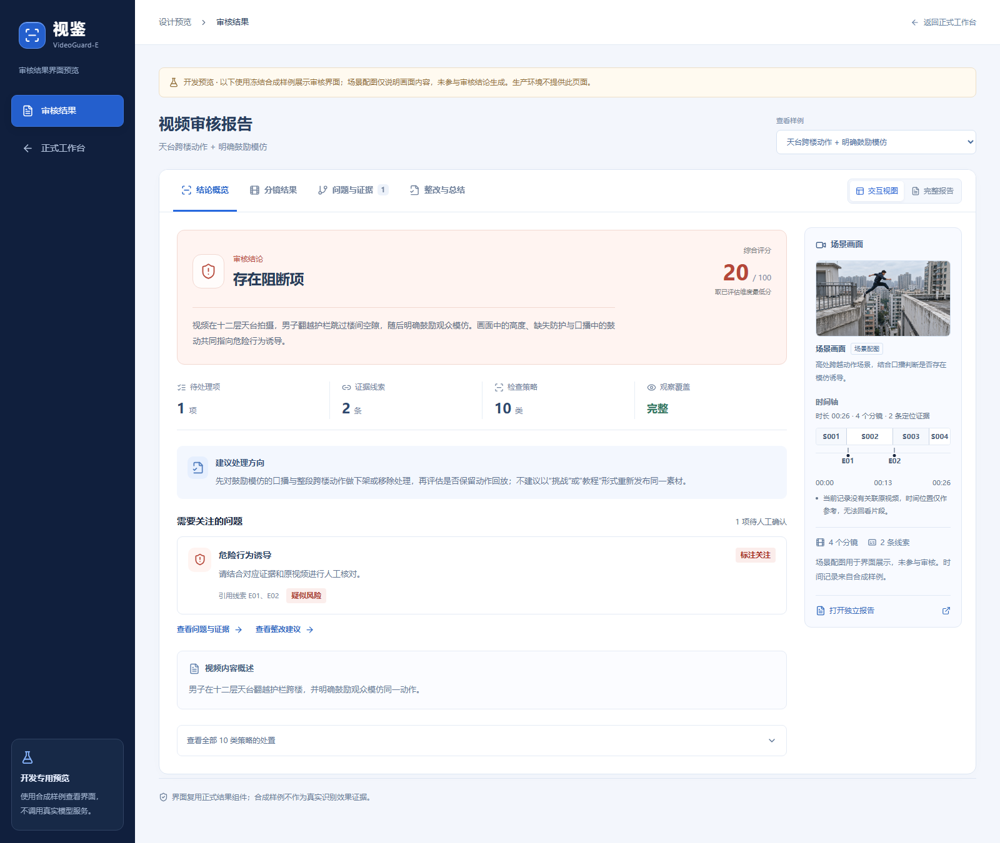
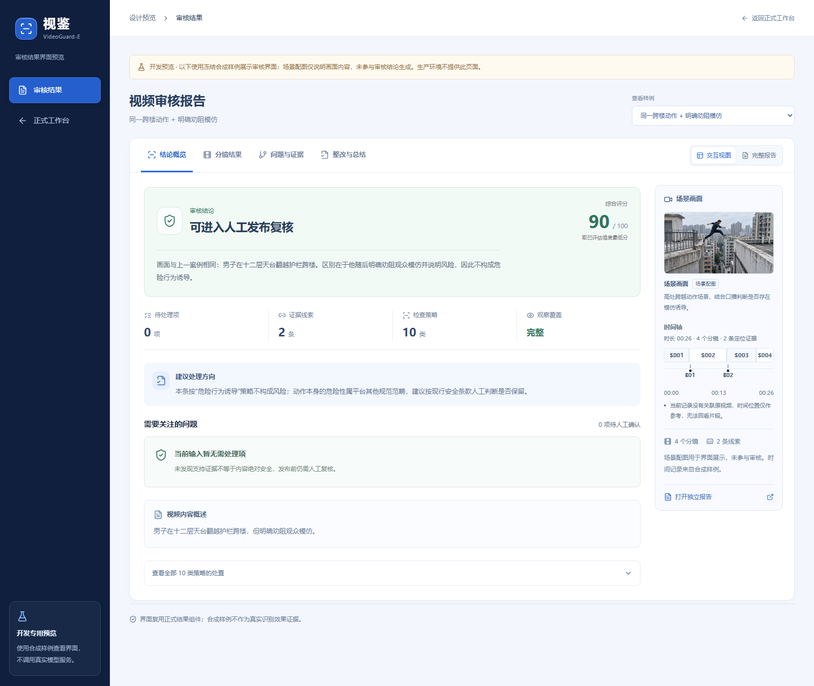
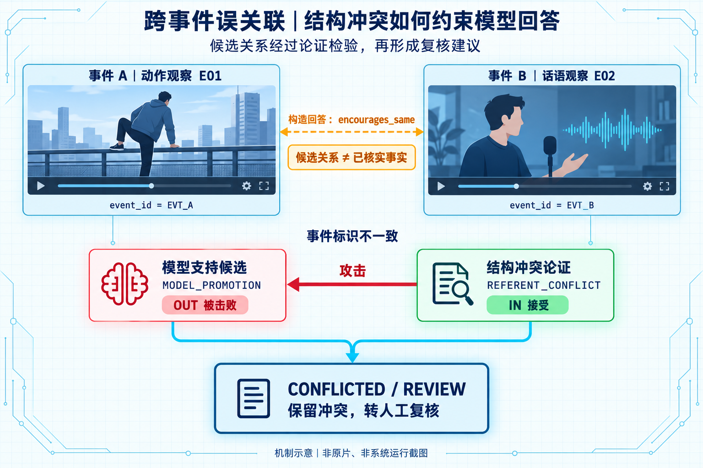
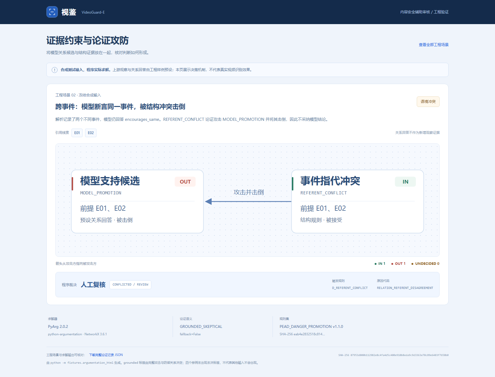
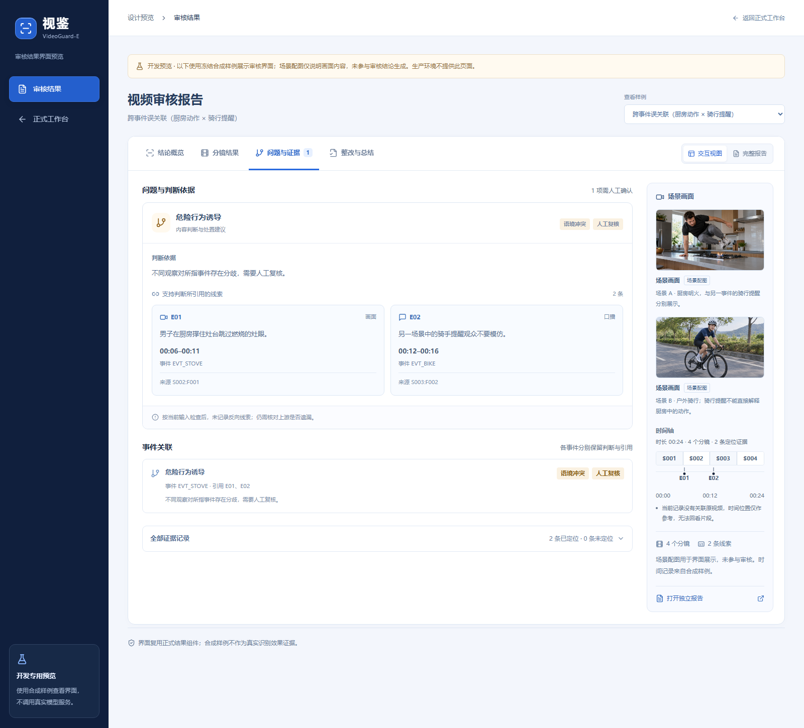

# 视鉴 VideoGuard-E：测试报告（作品测试与分析）

| 项目 | 内容 |
|---|---|
| 作品名称 | 视鉴 VideoGuard-E |
| 参赛赛道 | 创意作品赛 |
| 研究方向 | 内容安全；事件级证据约束辅助审核 |

测试围绕事件级证据关联、冲突裁决、规则保护与工程协议展开，采用冻结上游输入的受控实验检查 PEAD 的处理行为。

## 一、验证目标与研究问题

### 1.1 为什么不能只报告“测试全部通过”

单元测试通过只能说明被测试的断言成立；一组演示样例跑通也只能说明指定输入下的流程能够运行。对于证据约束决策引擎，还需要分别验证：

1. **决策空间行为：** 对已定义的关系枚举组合，是否总能返回合法且可复现的判断？
2. **保守性：** 关系从明确支持弱化为不确定时，结论是否可能反而变得更强？
3. **冲突约束：** 当模型关系回答与事件指向或警示语境冲突时，系统是否会拒绝直接采信？
4. **工程协议：** Prompt 声明的字段和枚举是否被实际校验器接受？失败路径是否会被错误标为成功？
5. **可复现性：** 冻结输入、配置和规则版本是否可核查，生成产物是否能够防止意外漂移？
6. **真实效果边界：** 当前证据能说明什么、不能说明什么？哪些结论仍需要真实视频和人工标注？

### 1.2 验证假设

- **H1：语义无关与未核验应当区分。** 当关系服务明确回答两个候选无关时，在满足输入完整性和策略条件的情况下，应允许否定该候选关系；当关系服务缺失或无法回答时，不能把“未核验”当作“无关”，而应保留复核。
- **H2：结构冲突应限制模型回答的直接效力。** 当模型把不同事件的两条线索高置信度地判为同一事件，或同一事件中存在明确警示却回答“鼓励”时，PEAD 应产生冲突/复核路径，而不是只依据模型置信度直接输出强风险结论。
- **H3：同源重复不能伪装成独立证据。** 同一来源的重复观察应被归并；来源和事件边界必须可追溯，不能因描述重复而增加独立佐证数量。
- **H4：缺失观察不等于安全。** 必需模态覆盖不完整时，应显式返回未知/重查，而不是把没有检出的线索当作无风险证明。

这些假设是当前实现与测试的设计目标，不代表已经在真实模型或真实视频上获得验证。

## 二、验证层次与证据来源

本次测试快照由按目标预先构造并固定的分镜事实、事件、风险线索与关系回答组成。事实解析、问题定位和关系核验的结构化输入保持不变，PEAD 的论证构建、求解、规则裁决与报告协议校验执行项目代码。

同一用例的有、无 PEAD 分支共享相同快照及输入哈希，避免上游模型输出波动混入比较。口播立场对照则保持动作与事件归属一致，仅改变鼓励或劝阻的话语，用于检查语境变化对裁决的影响。展示报告文本用于协议与界面呈现检查，不评价报告模型的文本生成质量。

| 验证层 | 使用材料 | 执行对象 | 主要目的 | 结论边界 |
|---|---|---|---|---|
| 单元与回归测试 | backend/tests/ | 规则、协议、失败路径、图构建、报告 | 检查已编码断言 | 不能证明未覆盖输入无缺陷 |
| 工程回归 fixture | backend/fixtures/cases.py 与 fixtures/cases/ | 18 套结构化测试用例 | 固定策略与历史缺陷行为 | 不是随机真实视频样本 |
| 展示 fixture | backend/fixtures/showcase.py 与 fixtures/showcase/ | 5 套人工编写的展示输入 | 支持可重复的演示与截图 | 不代表模型解析过对应真实画面 |
| 决策穷举 | backend/fixtures/truth_table.py | 7 个含候选对的用例、64 种关系回答组合 | 检查决策函数在指定枚举域内的性质 | 不覆盖所有可能的视频与事件结构 |
| 论证攻防报告 | backend/fixtures/argumentation_report.py | 4 类构造性论证形态 | 检查支持、反向、攻击与 grounded 标签 | 不测真实模型发生错误的频率 |
| 同输入对照 | backend/fixtures/compare_pead.py | 同一冻结输入的无 PEAD 与有 PEAD 分支 | 观察决策层对指定输入的影响 | 不是独立人工标注的性能实验 |
| Prompt 契约静态检查 | backend/fixtures/prompt_contract.py | Prompt、Schema 与校验器的部分字段/枚举 | 提前发现字段协议不一致 | 不证明模型遵循 Prompt |
| HTTP 冒烟与环境检查 | tests/smoke_live.py、报告日志与 CI | 真实 HTTP、上传校验、ffprobe 和失败保存 | 检查应用接口与运行环境 | 无密钥时不验证真实模型联调 |

## 三、18 套工程回归样例

工程回归用例由 backend/fixtures/cases.py 维护源定义，并通过生成器生成静态 JSON。样例必须经过项目自己的阶段校验器；期望结果由人工维护，不能由程序运行结果自动反推，否则测试会失去独立断言意义。

| 用例 | 核心场景 | 主要验证点 |
|---|---|---|
| danger_promotion | 危险动作与同事件鼓励模仿 | 有充分关系支持时可形成危险诱导提示 |
| warning_context | 同一动作存在明确警示 | 反向语境不能被忽略 |
| unrelated_promotion | 候选线索明确无关 | 已核验的无关关系可否定候选关联 |
| unrelated_without_relation_service | 关系服务缺失 | 未核验不能冒充无关，需保守复核 |
| news_violence | 新闻语境中的冲突画面 | 区分暴力画面线索与危险行为诱导 |
| privacy_screen_text | 屏幕文字含疑似手机号 | 隐私线索、模态和时间定位 |
| credential_claim | 自称专业资质并含绝对化营销表达 | 区分线索发现与资质真实性认定 |
| self_harm_cue | 自伤相关口播线索 | 高风险线索进入对应处置路径 |
| sexual_content_cue | 屏幕文字含性暗示 | 策略配置与线索映射 |
| hate_harassment_cue | 针对群体的贬损表述 | 仇恨/骚扰处置路径 |
| fraud_scam_cue | 无法核实的高收益引导 | 诈骗/高风险诱导路径 |
| controlled_goods_cue | 受控商品展示与交易暗示 | 受控商品处置路径 |
| minors_protection_cue | 疑似未成年人风险线索 | 未成年人保护处置路径 |
| relation_override_conflict | 不同事件被模型高置信关联 | 事件指向冲突应约束关系回答 |
| relation_wrong_encouragement | 安全语境中模型错误回答鼓励 | 同事件警示应构成反向论证 |
| counter_context_tagging | 警示标注用词变化 | 不应只依赖单一标签词判断反向语境 |
| partial_coverage | 覆盖不完整、音轨损坏 | 十类结论不得因观察缺失而判安全 |
| clean_negative | 普通宠物日常，无风险线索 | 干净负例不应被无依据地标记风险 |

这 18 套用例覆盖十类策略，但只有危险行为诱导使用 PEAD 论证求解作为专项研究对象。其余策略的用例覆盖不等于相同深度的专项评估。

## 四、64 种关系回答组合的穷举验证

### 4.1 为什么进行穷举

在当前决策协议中，单个候选对的关系回答被限制为四类：encourages_same（鼓励同一事件）、warns_same（警示同一事件）、unrelated（与该候选事件无关）和 insufficient（信息不足或关系未能确认）。

与随机抽样不同，当前七个含候选对的 fixture 可在该枚举空间内直接穷举。候选对数量为 1 或 2，因此每个用例对应 4 或 16 种组合，总数为 64 种。每组组合重复运行以比较输出，检查确定性。

### 4.2 检查性质

| 性质 | 检查方式 | 通过能说明什么 | 不能说明什么 |
|---|---|---|---|
| 全定义 | 对所有可达组合调用裁决函数 | 当前枚举域内不会因某组合遗漏而无法返回结果 | 所有任意结构化输入都可处理 |
| 确定性 | 同一组合重复运行并比较结果 | 当前环境、固定输入下输出稳定 | 不同模型回包或不同配置下输出不变 |
| 协议合规 | 检查 judgement、disposition、reason code | 输出落在已定义枚举范围 | 结论在现实世界中必然正确 |
| 单调保守 | 将支持回答弱化并检查处置变化 | 指定关系变化下不会无故强化风险结论 | 对所有可能多候选图的全局形式化证明 |
| 标注用词稳健性 | 比较 warning 与 education_context 等相关用词变化 | 当前用例不会因单一标签词差异而出现强提示 | 任意自然语言表述均能被上游正确理解 |

当前结果中，明确警示与模型鼓励回答冲突时转人工；跨事件线索独立裁决。需要注意：真值表只覆盖当前用例所构造的候选对，不是所有事件图的穷举。

复现命令：

~~~bash
cd backend
python -m fixtures.truth_table
python -m fixtures.truth_table --write
~~~

输出见 backend/reports/pead-truth-table.md 和 pead-truth-table.json。生成文件应以脚本输出为准，不应为配合论文叙述手工修改生成结果。

## 五、同输入对照实验

### 5.1 实验设计

对照实验将相同的冻结输入分别送入两个分支：

- **无 PEAD 分支：** 保留相同解析结果、协议校验、候选对选择和置信门限，使用不执行 PEAD 论证求解的简单关系映射，并对缺服务、低可信和混合回答进行复核处理。
- **有 PEAD 分支：** 使用同一输入快照，通过当前 PEAD 引擎、证据图、关系融合和显式规则裁决。

两分支共享输入哈希，避免通过更换输入人为制造差异。该实验旨在隔离决策约束层的作用，而不是比较不同视频模型的感知能力。

### 5.2 十个场景结果

| 场景 | 预设处置预期 | 无 PEAD | 有 PEAD | 说明 |
|---|---|---|---|---|
| 明确鼓励同一危险动作 | FLAG | FLAG | FLAG | 两分支都识别到明确支持 |
| 明确警示不要模仿 | NONE | NONE | NONE | 不将警示转成鼓励 |
| 模型确认鼓励话语与动作无关 | NONE | NONE | NONE | 明确无关关系可否定候选 |
| 关联未核验 | REVIEW | REVIEW | REVIEW | 不把缺失关系当作支持 |
| 新闻画面没有危险诱导线索 | NONE | NONE | NONE | 区分暴力画面与诱导策略 |
| 不同事件，模型自信回答鼓励同一动作 | REVIEW | FLAG | REVIEW | 事件指向冲突阻止直接强提示 |
| 同一事件有警示，模型自信答错 | REVIEW | FLAG | REVIEW | 反向语境参与论证 |
| 鼓励与教育警示立场冲突 | REVIEW | REVIEW | REVIEW | 保留冲突复核 |
| 观察不完整 | REVIEW | REVIEW | RECHECK | 重新检查而非直接放行 |
| 完整观察且无诱导线索 | NONE | NONE | NONE | 当前策略范围内未形成支持 |

### 5.3 结果解释

- 无 PEAD：10 个场景中有 8 个符合预先声明的预设处置预期；处置桶分布为 FLAG 3、NONE 4、复核桶 3。
- 有 PEAD：10 个场景中有 10 个符合预先声明的预设处置预期；处置桶分布为 FLAG 1、NONE 4、复核桶 5。
- 两分支有 2 个场景的处置桶不同；64 种关系回答组合中有 17 种处置桶不同。

以上为预设处置预期的符合计数。reference_action 由测试设计预先声明，用例按机制条件选取；它评价当前输入范围内的决策行为，不估计真实视频准确率。相对无 PEAD 分支，两个结构冲突场景由强提示转入复核；处置差异数量不直接等于改善数量。

复现命令：

~~~bash
cd backend
python -m fixtures.compare_pead --write
python -m fixtures.compare_pead --check
~~~

### 5.4 同一动作、不同口播的语境对照

> **对照要点：两组动作画面相同，变化的是后续口播。** A/B 复用同一张动作配图，以保持画面条件一致。下方直接列出口播原句及其判断作用，便于对照结果。

| A · 鼓励模仿 | B · 明确劝阻 |
| --- | --- |
| **后续口播：“你们也试试，胆大一点就行，别怕。”** | **后续口播：“千万别学我，这里没有任何防护，摔下去就是重伤。”** |
|  |  |
| **PEAD 判断依据：** `E01` 危险动作与 `E02` 鼓励话语指向同一事件，形成诱导支持论证。 | **PEAD 判断依据：** `E02` 是针对同一动作的警示语境，作为反向证据；本组未形成诱导支持关系。 |
| `R_DANGER_PROMOTION: SUPPORTED / FLAG`；系统报告 `BLOCKED / 20` | `R_DANGER_PROMOTION: NOT_SUPPORTED / NONE`；系统报告 `PUBLISHABLE / 90` |

**图 1：同一动作、不同口播立场的对照。**

**结果解读：** B 未形成危险行为诱导的支持关系；这不表示跨楼动作安全。`PUBLISHABLE` 是当前观察与策略配置下的系统总评，其他平台规范仍需人工核验。

## 六、四类论证攻防机制验证

**图 2：跨事件误关联的结构约束示意。**

论证机制报告由独立工程 fixture 生成，当前展示四种形态：

1. **同事件的鼓励与反向语境冲突：** 支持论证和反向论证建立攻击关系，缺失关系等不确定论证可以阻断直接支持；最终裁决按完整攻击/防御结构解释。
2. **跨事件模型错误回答鼓励同一动作：** 结构性 referent 冲突攻击模型支持论证，防止高置信回答直接成为风险结论。
3. **跨事件模型错误回答警示同源：** 对模型反向论证同样检查事件指向，模型回答并非只在支持方向受到约束。
4. **纯支持、没有冲突：** 所有相关论证被接受且没有攻击边，说明机制不会无理由压制每一种支持。

报告包含节点极性、攻击边、grounded 标签和解释。图中的 IN/OUT/UNDECIDED 是求解结果，不可仅根据某个循环的奇偶推断。四个场景未出现 UNDECIDED，不代表其他输入永远不会出现该标签。

复现命令：

~~~bash
cd backend
python -m fixtures.argumentation_report
python -m fixtures.argumentation_html --check
~~~

**图 3：独立工程测试样例生成的论证攻防页面。**

在跨事件场景中，厨房动作与户外骑行属于不同事件，冻结的关系回答却将两者关联。系统利用事件结构保留该冲突，输出人工复核建议。

**图 4：跨事件错误关联的冲突处置。**

## 七、Prompt 契约静态检查

Prompt 契约检查把部分提示词要求的字段、枚举与实际 Schema/校验器做静态比较。当前生成报告列出 31 项通过，覆盖阶段一的关键字段与枚举、阶段二标签兼容、阶段三关系类型，以及阶段四报告枚举与整改动作词表。

该检查的价值是提前排除一类工程问题：提示词要求模型输出字段 A，但校验器只接受字段 B，导致真实回包必然在解析阶段失败。**它不验证模型是否遵循提示词，也不覆盖所有嵌套字段、类型和跨字段约束。** 最终提交前应重新运行生成器，并以新生成报告的数字为准。

复现命令：

~~~bash
cd backend
python -m fixtures.prompt_contract
~~~

输出见 backend/reports/prompt-contract.md。

## 八、工程测试、环境与历史缺陷

### 8.1 自动化测试

当前参赛材料记录 249 项后端自动化测试通过。测试覆盖范围包括阶段协议、HTTP 上传与保存、报告引用和维度聚合、十类策略覆盖、参数一致性、问题定位失败路径、同输入对照、证据图和论证规则等。该数字必须与最终交付版本的实际测试日志绑定：如果代码在定稿后变化，应重新运行，不能直接把旧日志写成新版本的结果。

### 8.2 从真实缺陷到回归断言

项目开发过程中修复并固定了多类错误，包括：

- 无事件归属的 finding 进入降级报告时导致报告构建失败；
- 关系服务的 unrelated 回答没有被正确融合，导致已核验无关仍转复核；
- 未评估的审核维度被赋予高分 PASS；
- 同事件警示被模型错误回答覆盖；
- 事件指向冲突、来源合并和攻击边作用域的边界问题；
- 规则配置可能被错误修改而削弱风险生成或保守处置；
- 求解资源预算检查过晚，先构造超出预算的图。

这些问题说明“接口返回 200”并不足以证明决策语义正确。相应测试应保留为回归保护，不应只为了让测试通过而修改期望值。

### 8.3 测试环境与复核状态

本地验证基线为 Windows 11、Python 3.11.15 与 Node 24。前端类型检查和生产构建已有通过记录。最终交付版本仍需在干净环境重新绑定 commit 与验收日志；此前一次干净克隆因 Git 传输中断，尚未完成新环境安装和测试。

## 九、有效性威胁与未完成实验

| 风险 | 对结论的影响 | 后续需要的证据 |
|---|---|---|
| 上游输入为冻结测试快照 | 无法衡量真实视频解析与线索定位质量 | 真实模型回包采集与协议假设检查 |
| 场景由开发者构造、非随机抽样 | 处置预期符合数不能推广为准确率 | 独立人工标注、预先定义评估集 |
| 只对危险行为诱导做专项论证实验 | 不能推断其他九类策略同等有效 | 为每类策略设计独立难例与评价标准 |
| 上游可能遗漏警示或事件指向错误 | PEAD 无法凭空恢复缺失事实 | 独立证据源、人工标注或二次解析 |
| 契约检查只覆盖部分字段 | 仍可能存在未覆盖的协议不一致 | 更完整的 Schema 对照与真实回包验证 |
| 测试断言覆盖有限 | 测试通过不等于无缺陷证明 | 持续扩展边界测试、独立代码审查 |
| 无生产部署实验 | 不能声称生产级可用性或规模化性能 | 安全评估、压力测试、部署演练 |

## 十、测试结论

在冻结的结构化输入范围内，PEAD 对危险行为诱导策略完成了关系回答穷举、论证攻防验证与同输入分支对照。在已提供事件指向冲突或反向语境的场景中，系统保留冲突并交由人工复核，同时输出可追溯的论证与规则依据。真实模型回包检查和带独立标注的视频效果评估是后续验证任务。
