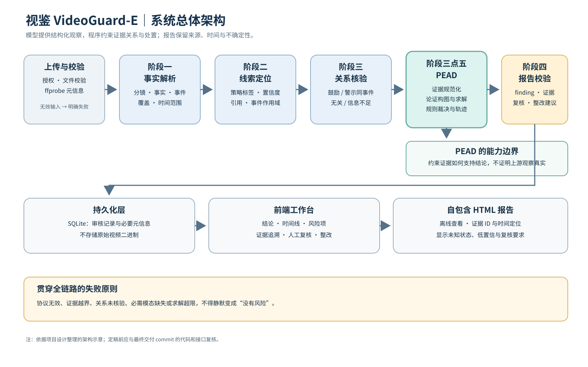
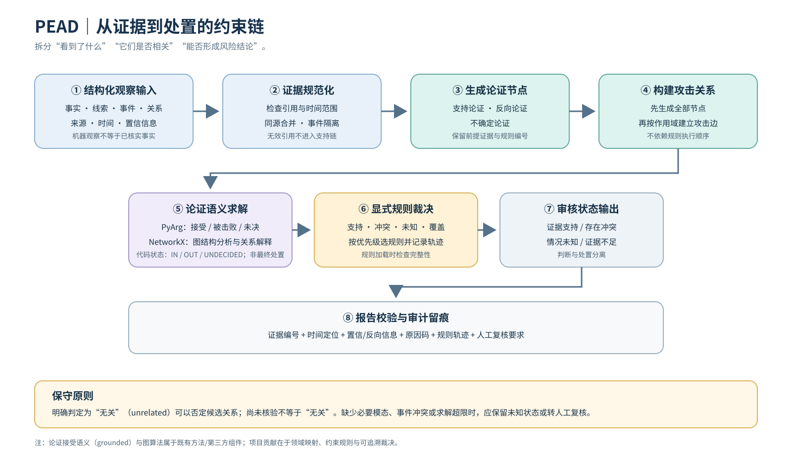
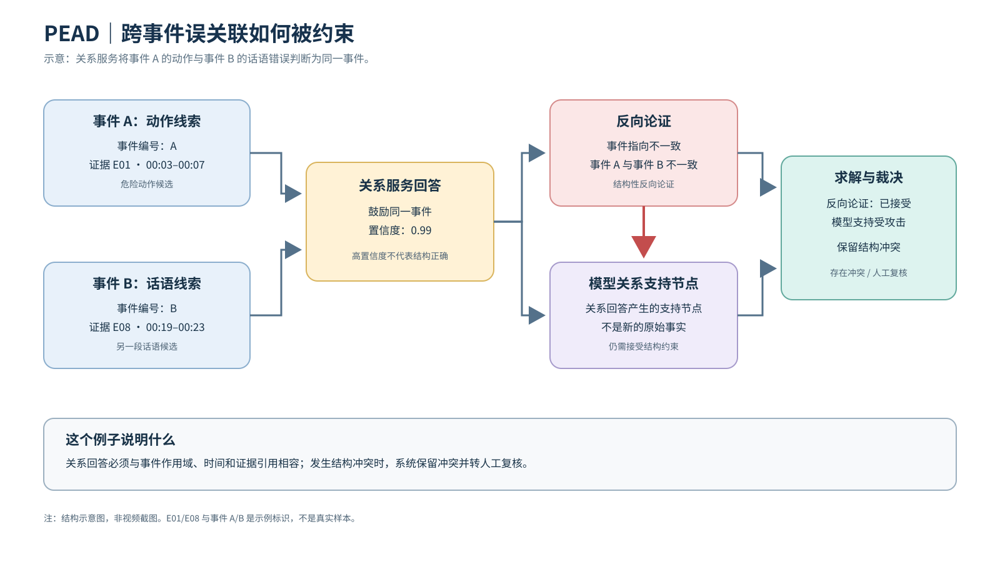

# VideoGuard-E：系统结构图与 PDF 配图说明

> 本文件是参赛报告的配图源文件索引。图中流程依据当前仓库设计整理，均为**结构示意图**，不是视频截图，也不声称来自真实模型调用。定稿前须与最终交付 commit 核对一次。

## 图 1：系统总体架构

**建议图注：** 图 1 视鉴 VideoGuard-E 系统总体架构。系统将上传校验、事实解析、风险线索定位、关系核验、PEAD 证据约束决策与报告校验串联，审核记录进入 SQLite，并由前端工作台和自包含 HTML 报告呈现。图中展示的是系统设计与模块关系，不代表每次真实视频调用均已成功完成所有阶段。

**建议放置位置：** 正文“系统总体架构”小节，建议横向通栏。图后解释：PEAD 是关系核验与报告构建之间的逻辑层，不是独立微服务；只有危险行为诱导策略使用专项论证求解。

## 图 2：PEAD 证据约束决策流程

**建议图注：** 图 2 PEAD 从结构化观察到审核处置的流程。系统依次进行证据规范化、同源合并、事件作用域隔离、论证节点生成、攻击关系构造、grounded 求解和显式规则裁决，最终把证据 ID、时间范围、原因码和复核要求写入报告。grounded 语义及图算法来自既有方法和第三方组件，项目工作集中于领域证据映射、规则约束和审计链路。

**建议放置位置：** 正文“核心技术 / PEAD”小节，紧接算法说明。不要把图中的每一个方框描述成独立模型调用；其中多个步骤由本地程序执行。

## 图 3：跨事件误关联的论证示意

**建议图注：** 图 3 跨事件误关联的约束示意。当关系服务将不同事件的动作与话语误判为同一事件时，事件标识不一致形成结构性反向论证，并攻击由关系回答生成的支持节点。系统保留冲突并按规则转人工复核。图中的 E01、E08、event_A 和 event_B 是说明性标识，不是真实视频样本。

**建议放置位置：** 正文“关键技术 / 关系冲突处理”或“实验结果 / 跨事件冲突”小节。应与同输入对照实验的真实生成报告分开引用，避免让评审误以为这张图是某次真实模型调用的截图。

## 图 4：前端与报告截图（待前端定稿后替换）

当前仓库已有的 docs/assets/demo/ 图片是某个历史 UI 版本的截图。前端完成优化后，应重新截图，优先保留以下证据：

1. 上传与授权确认；
2. 综合结论、风险项和未知状态；
3. 证据时间线与证据 ID；
4. 同动作、不同口播的对照结果；
5. 跨事件冲突转人工复核；
6. 整改建议或自包含 HTML 报告。

每张截图都必须记录：案例 ID、截图日期、代码 commit、输入来源（合成展示 / 真实授权视频）、页面名称与图注。若仍使用合成展示，图注必须明确“人工编写的合成输入，非真实视频识别结果”。

## 如何用于 PDF

- 三张 SVG 是矢量图，优先直接插入支持 SVG 的排版工具；如果提交模板只接受 PNG，使用 Inkscape 或其他矢量工具导出 2× 或 3× 分辨率 PNG，保持纵横比，不要截图再截图。
- PDF 中建议每页最多放一张技术结构图；图注紧跟图下方，正文先引用图号。
- 不要把图 3 的示意节点与真实视频帧拼成一张“证据链截图”。如果未来提供真实授权视频帧，应在独立图块中展示，并注明视频来源与时间点。
- 颜色只用于区分数据/处理/不确定状态，不能只依靠颜色传达语义；正文也应解释 SUPPORT、COUNTER、UNCERTAINTY 和 REVIEW。
- 最终 PDF 必须在 100% 阅读尺寸检查文字清晰度；另用文本提取确认图注没有丢失。

## 图件文件索引

| 文件 | 用途 | 图件性质 |
|---|---|---|
| docs/assets/submission/01-system-architecture.svg | 系统总体架构 | 结构示意 |
| docs/assets/submission/02-pead-decision-flow.svg | PEAD 处理流程 | 算法流程示意 |
| docs/assets/submission/03-cross-event-conflict.svg | 跨事件冲突与论证约束 | 机制示意 |
| docs/assets/demo/*.png | 当前版本 UI 展示 | 历史版本截图，需前端定稿后重截 |
